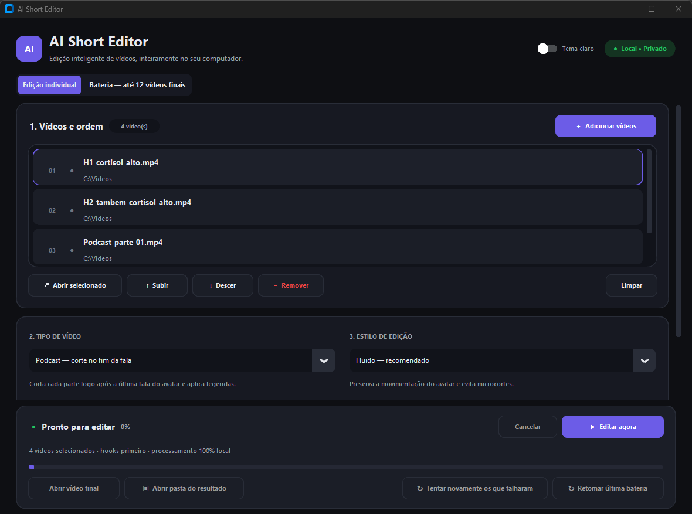
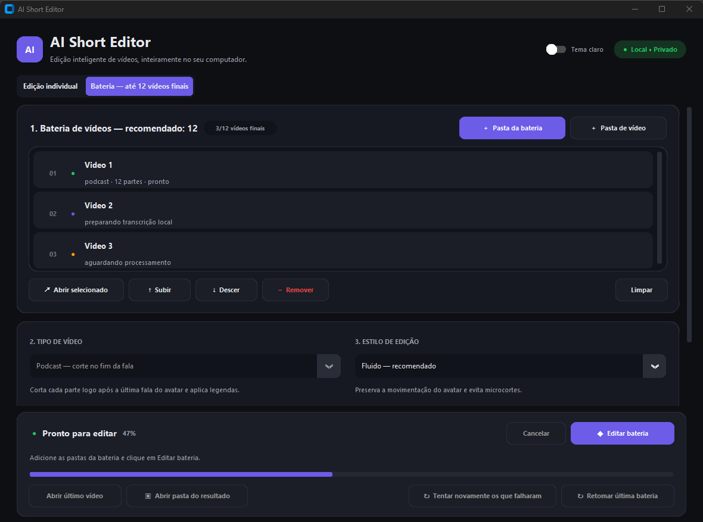
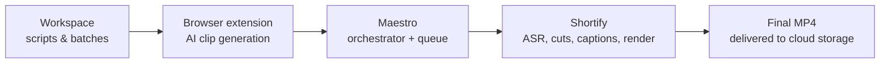

<h1 align="center">Setify</h1>

AI short-form video production platform, from script to final file

    

 &nbsp;  Shortify, the desktop editor: single and batch modes.

> **Note:** the source code is private (production systems). This repository is a technical overview: what it does, how it is built and what it looks like. Happy to walk through the code in an interview — reach me on [LinkedIn](https://www.linkedin.com/in/guilherme-vytacore/).

## Overview

Setify automates short-form video (shorts) production at scale. It is made of four parts that work together:

| Component | Role |
|---|---|
| **Workspace** | Organizes products, scripts and video batches |
| **Maestro** | Desktop orchestrator that moves each video through the pipeline (generation, download, editing, delivery) with an on-disk queue and safe resume |
| **Browser extension** | Automates bulk clip generation with generative video AI |
| **Shortify** | Desktop editor that assembles the final video on its own |

## Pipeline

## Shortify, the editor

- **Offline speech recognition** with faster-whisper / CTranslate2 — no paid API and no GPU required
- **Speech-aware cuts** that remove pauses while preserving the avatar's motion
- **Burned-in captions** with word-level highlight
- **FFmpeg rendering** with automatic quality checks
- **Batch processing** with checkpoints, retries and safe resume
- **Review timeline** with audio/video preview before export
- **Installers for Windows and macOS** (Apple Silicon and Intel) built with PyInstaller

## Tech stack

- **Desktop:** Python, CustomTkinter, faster-whisper, CTranslate2, ONNX Runtime, PyAV, NumPy, Pydantic, FFmpeg
- **Extension:** JavaScript, Chrome Extensions API (Manifest V3)
- **Quality:** pytest, ruff, black, GitHub Actions

---

<b>Versão em português</b>

> **Observação:** o código-fonte é privado (sistemas em produção). Este repositório é uma visão técnica do projeto. Posso apresentar o código em uma entrevista — fale comigo pelo [LinkedIn](https://www.linkedin.com/in/guilherme-vytacore/).

## Visão geral

O Setify automatiza a produção de vídeos curtos em escala, com quatro peças: **Workspace** (organiza produtos, roteiros e lotes), **Maestro** (orquestrador desktop com fila em disco e retomada), **extensão de navegador** (gera clipes com IA generativa de vídeo em massa) e **Shortify** (editor que monta o vídeo final sozinho).

## Shortify

- **Transcrição offline** com faster-whisper / CTranslate2, sem API paga e sem GPU obrigatória
- **Cortes pela fala**, preservando o movimento do avatar
- **Legendas gravadas** com destaque palavra a palavra
- **Render com FFmpeg** e verificação automática de qualidade
- **Processamento em lote** com checkpoints e retomada
- **Timeline de revisão** com prévia antes de exportar
- **Instaladores para Windows e macOS** (PyInstaller)

## Stack

- **Desktop:** Python, CustomTkinter, faster-whisper, CTranslate2, ONNX Runtime, PyAV, NumPy, Pydantic, FFmpeg
- **Extensão:** JavaScript, Chrome Extensions API (Manifest V3)
- **Qualidade:** pytest, ruff, black, GitHub Actions

